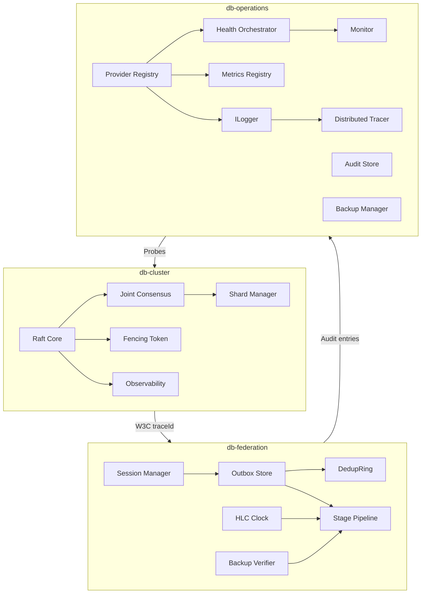
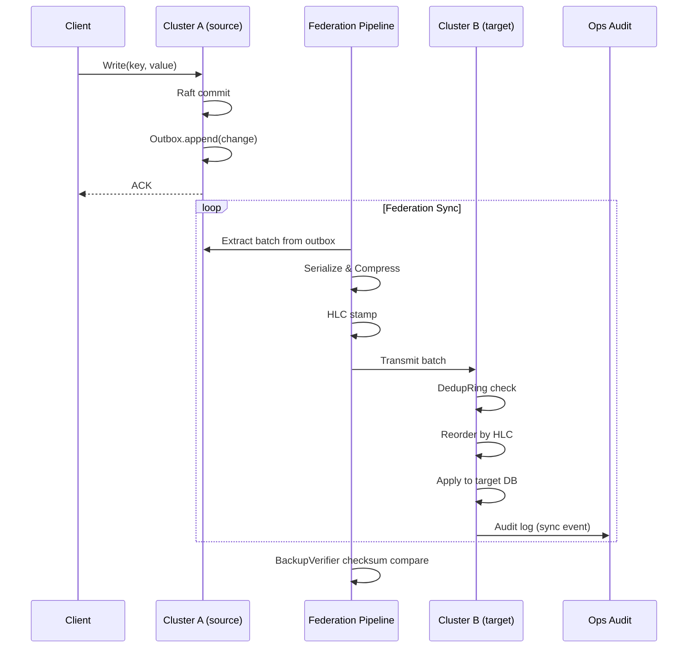

# Agentix-E Architecture Panorama

## Repository Topology



## Data Flow: Write Path



## Cross-Cutting Concerns

| Concern | db-cluster | db-federation | db-operations |
|---------|-----------|---------------|---------------|
| **Observability** | LoggingAdapter, RaftMetricsCollector, HealthProbe | Pipeline metrics, SessionManager heartbeats | InMemoryLogger, MetricsRegistry, HealthOrchestrator, DistributedTracer |
| **Security** | FencingToken | Audit trail | AuditStore, AuthProvider |
| **Testing** | 654 tests, coverage ≥95% | 424+ tests, coverage ≥95% | 1096 tests, coverage ≥95% |
| **CI** | Quality gates (lint, tsc, test, coverage) | Quality + Security + Cross-repo | Quality + Security |
| **ADR** | 001-006 | 001-004 | 001 |

## Module Map

```
workspace/
├── db-cluster/          # Raft consensus engine
│   ├── src/consensus/   # Raft core, joint consensus, fencing
│   ├── src/shard/       # Shard assignment & migration
│   ├── src/observability/ # Logging, metrics, health probes
│   └── docs/adr/        # 001-006
├── db-federation/       # Cross-cluster data sync
│   ├── src/outbox/      # Outbox Store
│   ├── src/dedup/       # DedupRing
│   ├── src/hlc/         # Hybrid Logical Clock
│   ├── src/pipeline/    # Stage-based pipeline
│   ├── src/session/     # Session Manager
│   └── docs/adr/        # 001-004
├── db-operations/       # Operations framework (20 packages)
│   ├── packages/core/   # Provider Registry (IoC)
│   ├── packages/logger/ # ILogger interface
│   ├── packages/metrics/# Metrics registry
│   ├── packages/health/ # Health orchestration
│   ├── packages/audit/  # Audit trail
│   ├── packages/backup/ # Backup & restore
│   ├── packages/monitor/# Deadlock, slow queries, connections
│   ├── packages/observability/ # Distributed tracing
│   └── docs/adr/        # 001
└── .github/             # Shared CI workflows
    └── workflows/
        └── cross-repo-ci.yml
```

## Iteration Index

| I | Topic | Repo | ADR | Tests | Commit |
|:--|------|------|-----|-------|--------|
| I1-I7 | Foundation | all | 001 (each) | ~1800 | — |
| I8 | Coverage + Flaky | db-cluster | — | 654 | `5050154` |
| I9 | Cross-repo Stress | db-federation | 003 | 13 | `54eaf6e` |
| I10 | Unified CI/CD | db-federation | — | — | `8e58b9a` |
| I11 | Perf Stress Tests | db-federation | 004 | 6 | `3bc15cb` |
| I12 | Security Audit | all | — | — | `dc2b9cb` |
| I13 | Observability | db-cluster + ops | 006 | 58 | `e2707f8` / `ccc1a68` |
| I14 | Documentation | all | 003-006 | — | in progress |
